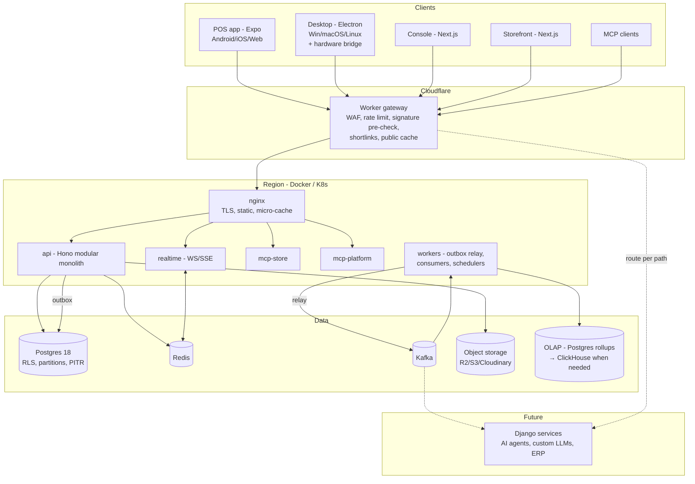

# ARCHITECTURE.md

High-level shape. Details live in `docs/architecture/*`. Decisions live in `docs/adr/*`.

## Style: modular monolith now, services when earned

We start as a **modular monolith with service seams** (ADR 0001), not a fleet of microservices.

- Each module owns its schema, its contracts, and its events. No cross-module table access.
- Modules call each other through typed ports (in-process today, HTTP/gRPC tomorrow).
- Side effects travel as events through a transactional outbox → Kafka.
- Extraction trigger: a module needs independent scaling, a different runtime (Django/Python AI), or a separate team. Then move its schema and handlers out; callers keep the same contract.

This gives microservice boundaries without paying distributed-transaction cost on day one.

## Topology



## Stack

| Layer | Choice | Why |
|---|---|---|
| Monorepo | pnpm workspaces + Turborepo | Matches Sahan repo; cached builds; Node 24 LTS, pnpm 12 (ADR 0008) |
| Language | TypeScript strict | One language across client, server, packages; packages ship TS source (ADR 0008) |
| POS client | Expo (React Native) + Expo Router | One codebase for Android, iOS, tablets, web (ADR 0002) |
| Desktop | Electron wrapping the Expo web export | Mature USB/serial/HID access, auto-update, kiosk mode, Linux support |
| Console / Storefront | Next.js (App Router) | Reuses Sahan admin patterns and auth-kit; SSR + SEO for storefront |
| UI kit | `@wise-biz/ui` on React Native primitives (renders on web via react-native-web) + Tailwind/NativeWind tokens | Shared components across POS and console widgets |
| Client state | Redux Toolkit (+ persist) for session/cart/UI; TanStack Query for server state | Requested; clear split between local truth and server cache |
| Local DB | SQLite: expo-sqlite (native, web OPFS), better-sqlite3 in Electron main | Offline source of truth on device |
| API | Hono on Node (deployable pieces on Workers) | Web-standard handlers; auth-kit already exports Hono helpers |
| Validation | zod schemas in `@wise-biz/contracts` → OpenAPI 3.1 + AsyncAPI 3 | One source for TS types, docs, Django codegen |
| ORM / SQL | Drizzle (typed SQL, explicit joins) | Predictable queries, no hidden N+1; auth-kit has a Drizzle adapter |
| DB | PostgreSQL 18 (native `uuidv7()`), Neon or self-hosted | RLS, partitioning, PITR |
| Cache / realtime | Redis (Upstash in cloud, Redis OSS self-hosted) | Rate limits, idempotency, pub/sub, permission cache |
| Events | Transactional outbox → Kafka (Redpanda in dev) | Durable, replayable, Django can consume |
| Search | Postgres FTS + pg_trgm + pgvector, fused by reciprocal rank | Hybrid search without another cluster (ADR 0007) |
| Media | `@sahan-sac/media-kit` (Cloudinary, S3, R2 failover) | Exists, signed uploads |
| Email | `@sahan-sac/email-kit` (Resend, Brevo) | Exists, fallback providers |
| AI | `@sahan-sac/ai-core` provider chain | Exists; DSS narratives, MCP assistant, suggestions |
| Auth | `@sahan-sac/auth-kit` (Better Auth engine) + tenancy extension | Exists; needs tenant scope, devices, PIN (see research) |
| Edge | Cloudflare Workers + KV/DO | Gateway, shortlinks, storefront cache |
| Proxy | nginx | TLS termination on self-host, micro-cache public GETs |
| Containers | Docker, compose for dev; Kubernetes optional later | |
| CI/CD | GitHub Actions + EAS Build (mobile) + electron-builder | `docs/architecture/deployment.md` |
| Observability | OpenTelemetry → Grafana stack or vendor; Sentry for clients | |

## Repository layout

```
apps/
  pos/            Expo app (Android, iOS, web)
  desktop/        Electron shell + hardware bridge (main process)
  console/        Next.js: store owner + platform admin
  storefront/     Next.js: online ordering
  api/            Hono modular monolith (mounts modules)
  realtime/       WS/SSE gateway
  workers/        outbox relay, Kafka consumers, cron jobs
  mcp-store/      tenant-scoped MCP server
  mcp-platform/   platform MCP server
  edge/           Cloudflare Worker gateway + shortlinks
modules/          one folder per bounded context (server side)
  identity/  tenancy/  devices/  catalog/  pricing/  inventory/
  sales/  payments/  orders/  customers/  loyalty/  staff/
  reporting/  insights/  billing/  integrations/  notifications/
  audit/  media/  theming/  support/
packages/         framework-free, reusable, publishable
  contracts/  money/  ids/  policy/  audit-chain/  sync/
  pricing-engine/  tax/  receipt/  hardware/  barcode/
  theme/  ui/  search/  entitlements/  mcp-core/  observability/
  config/ (eslint, tsconfig)   testing/
services/         extracted or non-TS services (future: django/)
infra/            docker/, nginx/, k8s/, cloudflare/, terraform/
docs/
```

Module internals (hexagonal, ADR 0001):

```
modules/sales/
  domain/        pure logic, no IO (entities, rules)
  application/   use cases: authorize → validate → transact → audit → outbox
  ports/         interfaces it needs (InventoryPort, PaymentsPort, Clock, Ids)
  adapters/      db (Drizzle), http routes (Hono), event handlers
  contracts.ts   re-exports from @wise-biz/contracts/sales
  schema.sql     owned tables (schema `sales`)
```

Module list with ownership and events: `docs/modules.md`.

## Request lifecycle (write)

1. Edge Worker: WAF, IP reputation, coarse rate limit, reject bad signatures early.
2. API middleware: request ID, tenant resolve, session or device token, request signature verify, CSRF/origin for browser calls.
3. Use case: `authorize(permission, scope)` → zod validate → idempotency check (Redis + DB unique key).
4. One DB transaction: domain writes + `audit.log` row + `outbox` row. `SET LOCAL app.tenant_id` for RLS.
5. Commit → response. Relay publishes outbox to Kafka. Consumers update projections, search, analytics, notifications.

## Offline and sync (summary)

Device keeps SQLite with catalog, prices, tax, permissions snapshot, customers subset, and its own sales. Sales are written locally, signed, appended to a device outbox, and pushed as commands when online. Server applies commands idempotently and streams back deltas by cursor. Terminals in one store also sync over LAN. Full design: `docs/architecture/offline-sync.md`.

## Django readiness

- Contracts first: OpenAPI and AsyncAPI generated from zod; Django implements the same contracts (pydantic models generated).
- Gateway routes by path prefix, so `/v1/insights/*` can move to Django without client changes (strangler fig).
- Shared auth: JWTs with tenant and permission claims, verified with JWKS by either runtime.
- Event bus is the integration point for AI agents and custom LLMs.
- Each module's schema is separate, so a Django service can own it outright after extraction.
