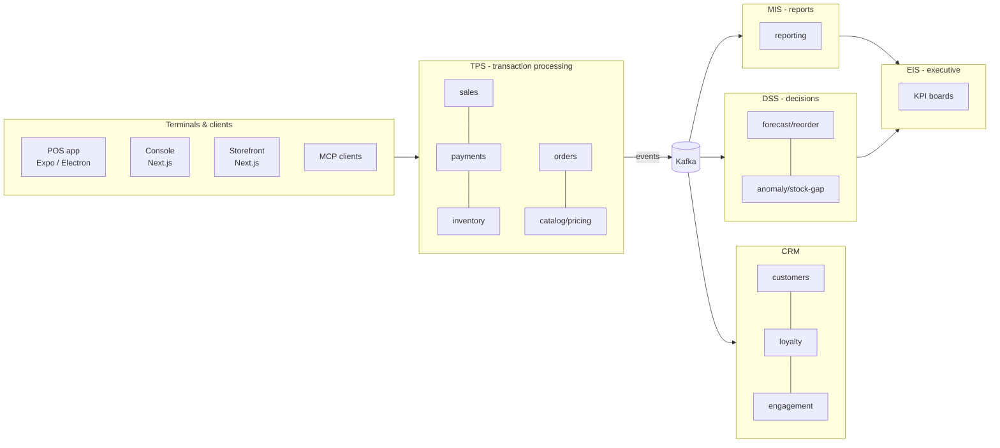

# SYSTEM.md

The platform is a system of systems. This file maps each information-system role to modules, and sets quality targets every module must meet.

## System of systems

| System | Purpose | Modules | Data style |
|---|---|---|---|
| **TPS** | Record every business event correctly and fast | sales, payments, inventory, orders, catalog, pricing, shifts | OLTP Postgres, strict transactions, offline-first on device |
| **CRM – operational** | Serve the customer at the counter and online | customers, loyalty | OLTP |
| **CRM – analytical** | Understand customers | analytics (RFM, cohorts, churn) | OLAP rollups |
| **CRM – collaborative** | Share customer context across staff and channels | notes, tickets, notifications | OLTP |
| **CRM – strategic** | Plan segments, campaigns, retention | campaigns, segments | OLAP + rules |
| **MIS** | Routine reports: sales, tax, stock, staff, Z-reports | reporting | Rollup tables, exports |
| **DSS** | Suggest actions: reorder, markdown, transfer, price, investigate gap | insights (rules + `@sahan-sac/ai-core`) | OLAP + models |
| **EIS** | Few numbers, all branches, trend + drill-down | console KPI board | Pre-aggregated |
| **ERP (future)** | GL, AP/AR, HR, procurement, manufacturing | new modules on same contracts | Django services allowed |

Rule: **TPS never depends on MIS/DSS/EIS/CRM-analytical.** Those consume TPS events. If analytics is down, selling continues.

## Quality attributes and targets

| Attribute | Target | How |
|---|---|---|
| **Latency (checkout)** | Scan→line p95 ≤ 50 ms; cash complete p95 ≤ 300 ms; print start ≤ 1 s | Local SQLite, in-memory catalog index, no network on hot path. `docs/architecture/performance.md` |
| **Latency (API)** | p95 ≤ 150 ms reads, ≤ 300 ms writes at region | Indexes, Redis cache, no N+1 |
| **Availability** | Selling: 100% while device has power (offline). Cloud API: 99.9% (P1), 99.95% (P2) | Local-first, multi-AZ DB, health-checked replicas |
| **Durability** | RPO ≤ 5 min cloud (PITR), 0 for completed sales on device (WAL + outbox) | Postgres PITR, daily logical backups, device WAL |
| **Recovery** | RTO ≤ 1 h region failure (P2) | Infra as code, restore drills each quarter |
| **Throughput** | 2,000 sales/s platform-wide sustained; 10k events/s bus (P2) | Stateless API, partitioned Kafka, batched writes |
| **Scale** | 50k tenants, 500k terminals, 1B ledger rows | Tenant-leading indexes, time partitioning, read replicas |
| **Consistency** | Sales/tender/stock movement atomic per sale; projections eventually consistent ≤ 5 s | Single DB transaction + outbox |
| **Integrity** | No sale edit without trace; tamper evidence | Hash-chained sales and audit, signed device commands |
| **Security** | OWASP ASVS L2 (P1), L3 for auth/payments (P2); PCI scope minimized | `docs/architecture/security.md` |
| **Accessibility** | WCAG 2.2 AA across console, storefront, POS | Token contrast checks, focus order, screen reader labels |
| **Usability** | New cashier sells within 5 min training | Simple default layout, progressive disclosure |
| **Compatibility** | Android 10+, iOS 16+, Win 10+, macOS 13+, Ubuntu 22.04+, evergreen browsers | Expo + Electron matrix in CI |
| **Maintainability** | Module extractable to service in ≤ 1 sprint | Contracts, events, no shared tables |
| **Observability** | Every request traced; every sale traceable device→DB→events | OpenTelemetry, structured logs, correlation IDs |
| **Portability** | Backend swappable (Node → Django) per module | OpenAPI + AsyncAPI contracts, gateway routing |

## Failure modes we design for

| Failure | Behavior |
|---|---|
| Internet down at store | Terminals sell offline; LAN sync keeps terminals consistent; card via terminal store-and-forward within limits; QR/online tenders hidden |
| One terminal dies mid-sale | Draft cart on disk; open on another terminal via LAN handoff or after sync |
| Duplicate submission | Idempotency key = sale UUID; server returns original result |
| Oversell while offline | Sale accepted; negative balance flagged; reconciliation task created |
| Clock drift on device | Server time offset tracked; device sequence numbers order events; HLC timestamps |
| Kafka down | Outbox keeps events in Postgres; relay resumes; no data loss |
| Redis down | Fall back to DB; rate limits fail closed for auth, open for reads |
| Bad deploy | Blue/green, feature flags, instant rollback; migrations expand/contract |
| Stolen device | Owner revokes in console; device keys rejected; local data encrypted at rest |
