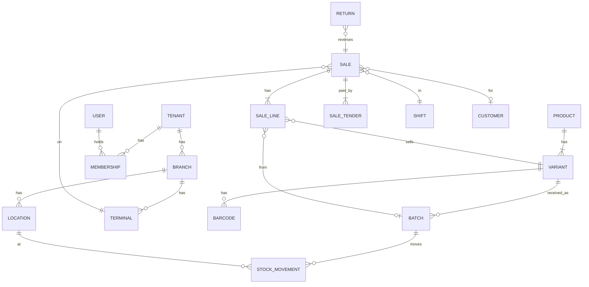

# Data model

## Principles

| Rule | Detail |
|---|---|
| IDs | UUIDv7 everywhere (`uuid` type). Server default `uuidv7()` (Postgres 18); clients generate with `@wise-biz/ids` for offline records. Time-ordered → B-tree friendly and sortable, without the random-insert page splits of UUIDv4. |
| Human numbers | Separate columns: `invoice_no` (tenant prefix + branch code + gapless sequence), `sale_no` per terminal. Never print UUIDs on receipts. |
| Tenancy | `tenant_id uuid not null` on every tenant table, **first column of every composite index**. RLS: `using (tenant_id = current_setting('app.tenant_id')::uuid)`. |
| Money | `bigint` minor units + `char(3)` currency. FX rate stored as `numeric(20,10)` snapshot on the document. |
| Quantities | `numeric(18,4)` (weights, fractional units). Base-unit quantity stored; display unit separately. |
| Time | `timestamptz` UTC. `business_date date` computed from branch timezone + cutoff hour. |
| Concurrency | `version int` on mutable rows → optimistic locking (`where id=$1 and version=$2`). |
| Soft delete | `deleted_at` only for master data (products, customers). Documents (sales) are never deleted; they are reversed. |
| Audit columns | `created_at, created_by, updated_at, updated_by, device_id` on business tables. |
| Schemas | One Postgres schema per module (`sales.sales`, `inventory.stock_movements`). |

## Core entities (P1)



### Sales table (sketch)

```sql
create table sales.sales (
  id uuid primary key,                    -- client-generated UUIDv7, also idempotency key
  tenant_id uuid not null,
  branch_id uuid not null,
  terminal_id uuid not null,
  shift_id uuid not null,
  operator_id uuid not null,              -- who rang it up (required)
  customer_id uuid,
  sale_no bigint not null,                -- per-terminal monotonic
  invoice_no text,                        -- assigned on server, gapless per branch
  status text not null check (status in ('completed','voided')),
  currency char(3) not null,
  subtotal_minor bigint not null,
  discount_minor bigint not null,
  tax_minor bigint not null,
  total_minor bigint not null,
  business_date date not null,
  device_seq bigint not null,             -- device outbox sequence
  prev_hash bytea not null,               -- hash chain per terminal
  hash bytea not null,
  signature bytea not null,               -- Ed25519 by device key
  completed_at timestamptz not null,      -- device clock (HLC-corrected)
  received_at timestamptz not null default now(),
  unique (tenant_id, terminal_id, sale_no),
  unique (tenant_id, terminal_id, device_seq)
);
create index on sales.sales (tenant_id, branch_id, business_date);
create index on sales.sales (tenant_id, customer_id, completed_at desc) where customer_id is not null;
```

`sale_lines` stores **snapshots**: name, unit price, tax rate, discount breakdown, batch_id, cost at sale time. Reports never re-join current prices.

### Inventory ledger

```sql
create table inventory.stock_movements (
  id uuid not null,
  tenant_id uuid not null,
  location_id uuid not null,
  variant_id uuid not null,
  batch_id uuid,
  qty numeric(18,4) not null,             -- +in / -out, base unit
  reason text not null,                   -- sale, return, receive, adjust, transfer_in/out, count_variance, writeoff, expiry
  source_type text not null,
  source_id uuid not null,
  source_line int not null,               -- line index within the source document
  unit_cost_minor bigint,
  occurred_at timestamptz not null,
  primary key (tenant_id, occurred_at, id)
) partition by range (occurred_at);       -- monthly partitions
create unique index on inventory.stock_movements (tenant_id, source_type, source_id, source_line, occurred_at);
```

The unique index makes replays idempotent: re-applying the same sale cannot double-move stock.

`stock_balances (tenant_id, location_id, variant_id, batch_id) → qty, reserved, version` is updated **in the same transaction** as the movement insert (`insert … on conflict do update set qty = stock_balances.qty + excluded.qty`). A nightly job re-derives balances from the ledger and alerts on drift.

Negative balances are allowed (offline oversell) and surface as exceptions, not blocked sales.

### Batches and FEFO

`batches(id, tenant_id, variant_id, lot_code, expires_on, unit_cost_minor, sale_price_minor null, received_at, supplier_id)`.

At sale: if the variant tracks batches, pick the earliest `expires_on` with positive balance at the location. If the batch has its own `sale_price_minor`, it wins over the price list (same product, different prices per batch). Expired batches are blocked from sale unless an override permission is used.

### Invoices and numbering

- Device assigns `sale_no` locally (gapless per terminal).
- Server assigns legal `invoice_no` from `invoice_sequences(tenant_id, branch_id, prefix, next)` with `update … returning` inside the sale transaction → gapless, no race.
- Offline receipts print `terminal code + sale_no`. The invoice number goes on the digital receipt and on reprint. Countries requiring a fiscal number at print time get a pre-allocated number block per terminal (P2).
- Custom prefixes per tenant/branch (`{PREFIX}-{BRANCH}-{YYYY}-{SEQ:6}`), configured in console.

## Index rules

1. `tenant_id` leads every composite index.
2. Every foreign key has an index.
3. List endpoints use keyset pagination on `(tenant_id, id)` — UUIDv7 makes `id` time-sortable.
4. Partial indexes for hot filters (`where deleted_at is null`, `where status='open'`).
5. Large append-only tables (movements, audit, outbox history) are range-partitioned by month; old partitions archive to object storage as Parquet.
6. `EXPLAIN (ANALYZE, BUFFERS)` on every new query in review; reject sequential scans on large tables.
7. Unique constraints carry business rules (barcode unique per tenant, invoice_no unique per branch).

## Multi-currency

- Tenant base currency; branch currency; sale currency = branch currency.
- Foreign-currency tender stores `amount_minor`, `currency`, `fx_rate`, `base_amount_minor`. Rate comes from a `pricing.fx_rates` snapshot (manual or provider), cached on device with validity.
- Reports convert to base using the stored snapshot, never today's rate.

## Retention

| Data | Hot | Archive |
|---|---|---|
| Sales, invoices | 7 years (country rule configurable) | Parquet in object storage after 2 years |
| Stock movements | 2 years | Parquet |
| Audit log | 7 years | WORM bucket (object lock) |
| Device heartbeats | 90 days | dropped |
| Analytics events | 13 months raw | rollups kept |
