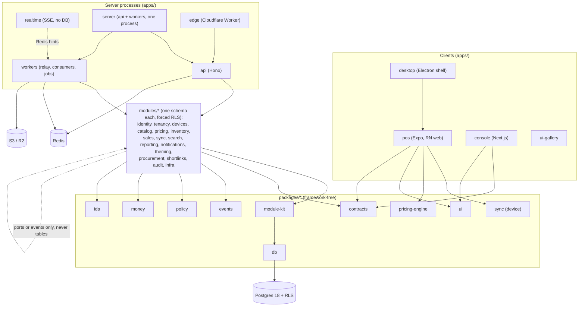
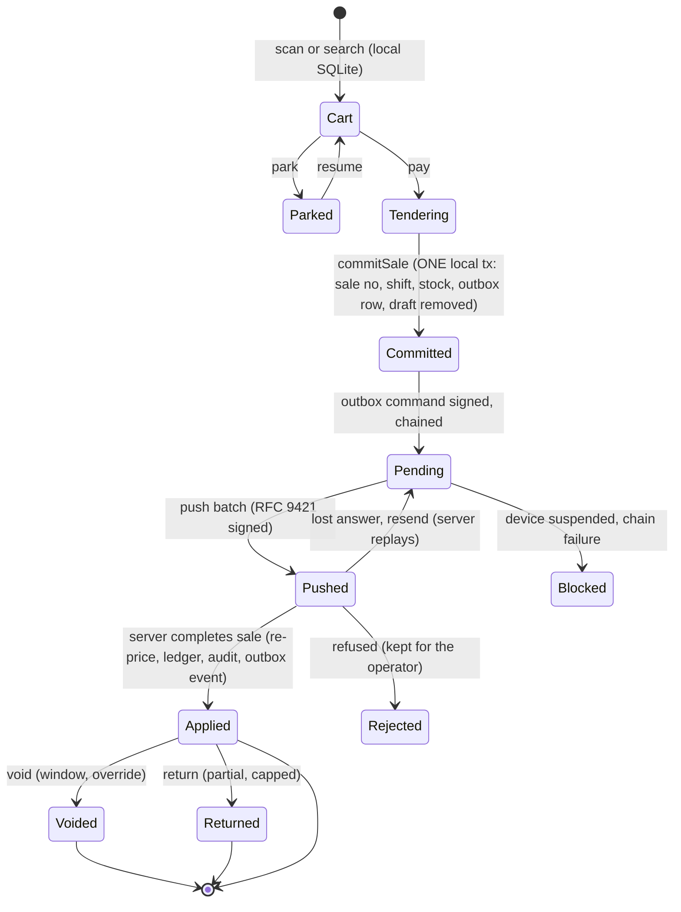
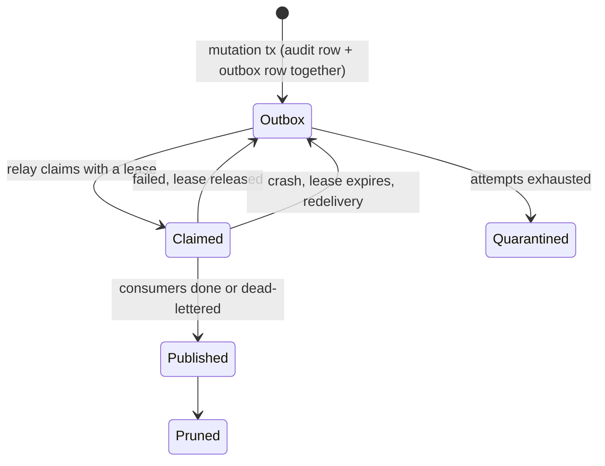

# Architecture graphs

Maps of the system as built (2026-11-08). Sources: `ARCHITECTURE.md`, `docs/modules.md`, `modules/registry.json`, `.dependency-cruiser.cjs`, ADRs 0001, 0003, 0006, 0014, 0015, 0016. If a graph and the code disagree, fix the graph. Regenerate the real import graph with `pnpm deps:graph`.

## Structure: who may import whom

Enforced by `pnpm depcruise`: modules never import `apps/`, packages never import frameworks, domain code never imports adapters, infra or Node I/O, no cycles, no deep imports into another module.

## State: a sale, from scan to ledger

Checkout never waits on the network: everything up to `Pending` runs against local SQLite (non-negotiable 4).

## State: an event, from mutation to consumer

Delivery is at-least-once; consumers dedupe on `processed_events`. Order per key is only guaranteed by the Kafka adapter (see `events.md`), so consumers must tolerate reordering.
